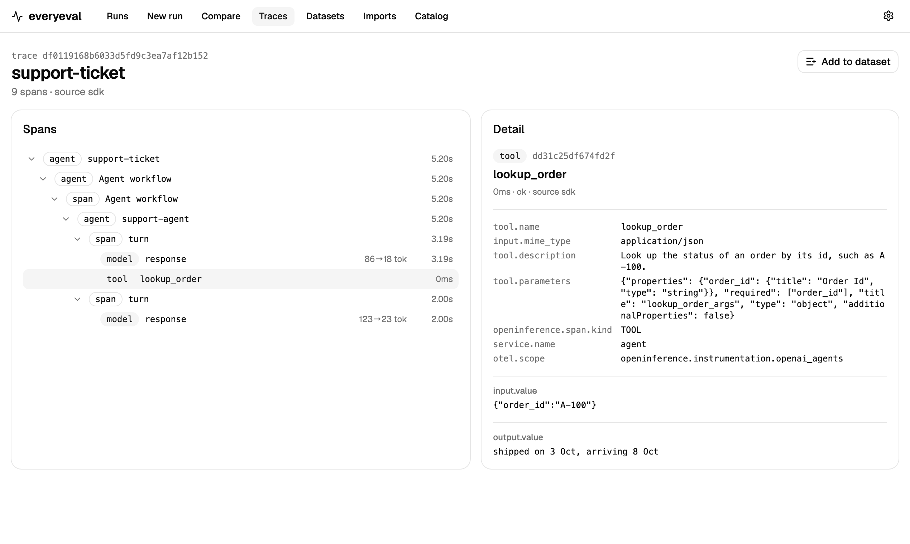

# everybench

[](https://pypi.org/project/everybench/)
[](https://github.com/trycedar0x/benchmark-tracing/actions/workflows/ci.yml)
[](LICENSE)
[](pyproject.toml)

Evaluate the agent you already run: load benchmark cases, invoke your callable or HTTP service, collect its real answer and execution trace, grade the results, and compare changes. Open source, local-first, no account needed. Existing model benchmarks remain available.

The SDK and CLI share one user-agent evaluation engine. Configure invocation and trace acquisition independently; inspect outcomes and component scores in the CLI or web UI.

User-agent evaluation does not construct an agent or require Docker. [Inspect AI](https://github.com/UKGovernmentBEIS/inspect_ai), [inspect_evals](https://github.com/UKGovernmentBEIS/inspect_evals) and Harbor remain compatibility runners for existing model/sandbox benchmarks. EveryBench adds:

- **User-owned targets.** Existing callable/HTTP agents, independently authorized trace sources, real identity/version/configuration and explicit failure states.
- **A versioned catalog.** Each entry pins one benchmark variant (task, arguments, grader). Different variants and grading contracts are never silently compared.
- **Compatibility-runner quotes and reported-cost caps.** Existing model runners retain estimates/budget controls; user-owned remote execution has unknown total cost, not an all-inclusive billing cap.
- **Actual execution evidence.** Captured model/tool actions form task-linked traces. Missing, withheld or evaluator-only evidence cannot replace the agent's own execution.
- **Paired comparison.** Per-task changes, bootstrap score-difference intervals and McNemar's test, with execution errors reported separately from incorrect answers.
- **Target-aware identity checks.** Legacy single-model revision checks remain; legitimate multi-model external agents retain their composition without false revision-drift rejection.

## Evaluate your existing agent

Start with [the user-agent SDK/CLI guide](docs/evaluating-your-agent.md): callable/custom-benchmark examples, strict HTTP/NDJSON targets, separate trace authorization, reports and comparison. `everybench evaluate` currently includes two explicitly configured experimental finance adapters; other benchmarks can implement the neutral SDK contract. No default paid evaluator or automatic retry is supplied.

[Acceptance evidence](docs/user-agent-evaluation-acceptance.md) records offline integration and one authorized financial-app case, including its failed raw-data matching component. The single-case result is not official leaderboard parity or authorization for another run.

## Quick start

Install the benchmark suite with [uv](https://docs.astral.sh/uv/) and configure a provider key. The evaluation below calls a paid model and asks for confirmation:

```bash
uv tool install --python 3.12 "everybench[benchmarks]"
export OPENAI_API_KEY=...
everybench catalog
everybench run gsm8k -m openai/gpt-4o-mini --limit 20
everybench serve                                     # web UI at http://127.0.0.1:8321
```

After a run finishes, use `everybench show <run-id>` to inspect its samples and `everybench trace <run-id> <sample-id>` to view a task's span tree.

Alternatively, use `pip install "everybench[benchmarks]"`. From a clone, run `uv sync --extra benchmarks` and prefix commands with `uv run`, as the rest of this README does.

New here? The [user guide](docs/guide.md) walks through reading comparisons, tracing your own agent and gating CI, and [`examples/`](examples) has runnable CLI, SDK, OTLP and HTTP API examples.

## Real models and benchmarks

```bash
uv sync --extra benchmarks            # installs inspect_evals; or: uv tool install --python 3.12 "everybench[benchmarks]"
export OPENAI_API_KEY=...             # or any provider Inspect supports

uv run everybench quote create gsm8k -m openai/gpt-4o-mini -m anthropic/claude-haiku-4-5 --limit 200
uv run everybench quote approve <quote-id> --cap 5
uv run everybench run --quote <quote-id>
```

Model names follow [Inspect's provider format](https://inspect.aisi.org.uk/models.html). everybench ships no real provider prices because they change; add the models you use to `~/.everybench/pricing.yaml` (see [`src/everybench/pricing.yaml`](src/everybench/pricing.yaml)). Models without a price get token counts but cannot run with a budget cap.

Commands that call paid models ask for confirmation, or take `--yes`.

## Agent benchmarks with Harbor

Agent benchmarks (Terminal-Bench, SWE-bench Verified, Aider Polyglot) run through [Harbor](https://github.com/laude-institute/harbor) in Docker sandboxes. Each trial becomes a sample with its reward, tokens, cost and an ATIF trajectory converted into model and tool spans.

```bash
uv sync --extra harbor                # or: uv tool install --python 3.12 "everybench[harbor]"
uv run everybench run terminal-bench -m terminus-2:openai/gpt-4o --limit 10 --yes
```

Models take the form `agent:model`, or a bare model for the catalog's default agent. To benchmark your own agent, pass its Harbor agent class with `--agent package.module:AgentClass`; [`examples/tau3_agents`](examples/tau3_agents) has a retail support agent (OpenAI Agents SDK) and a bank support agent (LangGraph) scored on tau3-bench (2026), and [Shipping a retail support agent](docs/retail-agent-guide.md) walks through how a team uses everybench to test changes to one. `oracle` (the reference solution) and `nop` (does nothing) are free. Harbor resolves registry datasets to their latest version. Every trial's task checksum is recorded, and runs whose task contents differ are blocked from direct comparison. With `--budget`, a run stops when Harbor-reported cost reaches the cap. Agent benchmarks pull large images; SWE-bench needs substantial disk space.

## Web UI and server

```bash
npm --prefix web ci && npm --prefix web run build   # builds the UI into the Python package
uv run everybench serve                              # http://127.0.0.1:8321, with 2 embedded workers
```

Or run everything with Postgres in Docker. Authentication is on in this setup, so set a secret key and create the first user:

```bash
export EVERYBENCH_SECRET_KEY="$(openssl rand -hex 32)"
docker compose up --build -d
docker compose run --rm api everybench admin create-user you@example.com --workspace main
```

The API, a worker and Postgres start, and the UI is at http://127.0.0.1:8321. Over the API, paid models need an approved quote (`EVERYBENCH_REQUIRE_QUOTE=0` disables this).

The UI is built with [shadcn/ui](https://ui.shadcn.com) (Nova preset). Browser smoke tests: `npx --prefix web playwright test` against a running server.

## Tracing your own agent

Send traces from your own code with the SDK (`pip install everybench`), or point any OpenTelemetry OTLP/HTTP exporter at `/v1/traces`. Spans from OpenInference and GenAI-semantic-convention instrumentations (OpenAI, Anthropic, LangChain and others) are mapped to model, tool and agent steps.

```python
from everybench.sdk import EveryBench

ee = EveryBench("http://127.0.0.1:8321", content="metadata")   # or "redacted" / "full"
with ee.trace("answer-question", task_id="q-17"):
    with ee.span("call-model", kind="model", **{"gen_ai.request.model": "gpt-4o-mini"}) as span:
        ee.record(span, "output", "...")                         # kept only if the policy allows
print(ee.flush().receipts)                                       # per-trace receipt: expected vs received spans
```

An [OpenAI Agents SDK agent](examples/openai_agents_trace.py) traced through OpenInference, with its model calls and tool call:



Exported batches use a local disk spool with fsync and atomic rename before delivery, and are removed after acknowledgement; buffered spans not yet exported can still be lost on a crash. Content policy is applied before spool persistence. Stable batch IDs prevent duplicate storage after a lost acknowledgement; full spools refuse spans and expose health failures. Producer seals declare expected span counts, allowing received traces to be marked closed or incomplete. A closed trace proves receipt of what the producer declared, not complete instrumentation or disclosure; withheld/partial content remains explicit. Existing buffering/spool edge cases are not a universal crash-safety guarantee.

The server stores ingested content according to `EVERYBENCH_INGEST_CONTENT` (default `metadata`). A client can ask for a stricter policy than the server's, but not a looser one.

## Imports and datasets

Import production traces from other tools, then turn interesting ones into reviewed evaluation tasks.

```bash
export LANGFUSE_PUBLIC_KEY=... LANGFUSE_SECRET_KEY=...           # or LANGSMITH_API_KEY, BRAINTRUST_API_KEY
uv run everybench import langfuse --max-traces 200 --rights own_data
uv run everybench import langsmith --project support-bot --rights own_data
uv run everybench import braintrust --project support-bot --rights own_data
uv run everybench import otlp spans.jsonl --rights own_data      # OTLP/JSON files
uv run everybench import inspect-log run.eval                   # an existing Inspect log becomes a run

uv run everybench dataset create "support failures"
uv run everybench dataset add <dataset> --run <run> --outcome incorrect --split dev
uv run everybench dataset review <item> --reference "..." --split test --approve
uv run everybench dataset export <dataset> -o tasks.jsonl       # approved items only, Inspect-compatible
```

Importing requires declaring your usage rights. Re-importing a trace replaces it instead of duplicating it. Dataset items start as drafts. The recorded output is kept as evidence and is never used as the reference answer automatically. An item can only be approved once a reviewer has set a reference answer, assigned a dev or held-out test split, and confirmed usage rights. The same flow is in the web UI under Imports and Datasets.

## Teams: authentication and workspaces

Authentication is off by default (single-user local mode, bound to localhost). For a shared server:

```bash
export EVERYBENCH_AUTH=1 EVERYBENCH_SECRET_KEY="$(openssl rand -hex 32)"
uv run everybench admin create-user you@example.com --workspace main      # prompts for a password
uv run everybench admin create-key --workspace main --name ci             # prints a bt_... key once
uv run everybench admin set-secret OPENAI_API_KEY --workspace main        # encrypted provider key
uv run everybench serve --host 0.0.0.0
```

- Every run, trace, quote, import and dataset belongs to one workspace. Members only see their own workspaces.
- Roles: owners manage secrets, members create runs and keys, and viewers are read-only.
- The browser uses an HttpOnly session cookie. Scripts, the SDK and OTLP exporters send `Authorization: Bearer bt_...`. Only key hashes are stored.
- Provider keys and import credentials are stored encrypted (Fernet, keyed from `EVERYBENCH_SECRET_KEY`). They are passed only to that workspace's run processes and imports, and are never returned by the API.
- Put TLS in front of the server before exposing it beyond your machine.

The database schema is managed with Alembic migrations, applied automatically on startup.

## Commands

| Command | What it does |
| --- | --- |
| `catalog [BENCHMARK]` | List benchmark variants, or show one |
| `quote create BENCH -m MODEL...` | Run a few samples per model and estimate full-run tokens and cost |
| `quote approve ID --cap USD` | Approve a quote with an optional budget cap |
| `run BENCH -m MODEL...` | Run with live progress; `--limit`, `--epochs`, `--budget`, `--content` |
| `run --quote ID` | Run an approved quote |
| `runs`, `show RUN` | List runs; show a run's summary, versions and samples |
| `trace RUN SAMPLE` | Print the span tree for one task |
| `compare A B` | Paired comparison; `--json` for every row |
| `diff A B SAMPLE` | Where the two runs' trajectories for one sample diverged |
| `cancel RUN` | Stop a running run gracefully |
| `import SOURCE`, `dataset ...` | Import traces; draft, review and export datasets |
| `admin ...` | Create users, workspaces, API keys and encrypted secrets |
| `serve`, `worker` | Start the API and web UI; run queued jobs in a separate process |
| `export RUN` | JSON export, or `--format eee` for [Every Eval Ever](https://github.com/evaleval/every_eval_ever) (needs `--extra eee`; real providers only) |

## How it works

User-agent `evaluate` runs the shared SDK engine: select original cases, invoke the existing agent once per case, acquire independently configured traces, grade and persist policy-filtered evidence/reports. Legacy `run` experiments execute in child processes through Inspect or Harbor; their hooks/trajectory conversion retain existing task traces. Both paths preserve distinct execution failures and incorrect scored answers.

State lives in `~/.everybench` (override with `EVERYBENCH_HOME`): a SQLite database and the original Inspect logs, which open in [Inspect View](https://inspect.aisi.org.uk/log-viewer.html). Set `EVERYBENCH_DATABASE_URL` to use Postgres.

Existing setups keep working: legacy `EVERYEVAL_*` and `BENCHTRACE_*` variables are read when the `EVERYBENCH_*` setting is unset (in that order). Existing `~/.everyeval` or `~/.benchtrace` data folders and database files are used until `~/.everybench` exists. Old span attributes and request headers remain accepted, and `bt_` API keys still work. Update Python imports to `everybench` and use `EveryBench` for the SDK client.

### Content policy

`--content full` (default for benchmark runs) stores prompts and outputs. `redacted` stores them after best-effort secret redaction. `metadata` stores only timings, token counts, scores and structure. Redaction catches common credential formats and sensitive field names; it cannot catch every secret in free text. Original Inspect logs are kept locally in full regardless of policy.

## Status

Early but complete for its first scope: CLI, API server and job queue, web UI, traces and trace diff, OTLP ingest and SDK, imports and dataset drafts, Harbor agent benchmarks, and workspaces with authentication. Not yet: remote execution backends (Modal, Daytona, Kubernetes), custom HTTPS scorers, and configuration tuning.

## Development

```bash
uv sync --extra benchmarks --extra eee --extra postgres --extra finance
# For legacy Harbor validation, use a separate environment and replace --extra finance with --extra harbor.
# --all-extras is intentionally incompatible: finance needs OpenAI >=3.4, Harbor/LiteLLM needs <3.
uv run pytest                                   # SQLite
EVERYBENCH_TEST_POSTGRES=postgresql+psycopg://postgres:pw@localhost/postgres uv run pytest   # Postgres
uv run ruff check src tests
npm --prefix web ci && npm --prefix web run build
```

Internal smoke-test fixtures are excluded from the public catalog and benchmark picker. Developers can inspect them with `uv run everybench catalog --include-internal`; explicit fixture runs remain available for tests. `bash examples/cli_tour.sh` exercises the pipeline offline in a throwaway data directory.

Evaluate your own callable or HTTP agent using the shared SDK/CLI engine: [User-agent evaluation guide](docs/evaluating-your-agent.md).

Experimental finance tasks and their offline validation workflow are documented in [Finance evaluations](docs/finance-evaluations.md). They are not listed in the public catalog; live-service validation is still pending, and finance quotes/all-inclusive budget caps are intentionally disabled.

## License

Apache-2.0. Benchmark datasets keep their own licenses, listed in the catalog.
